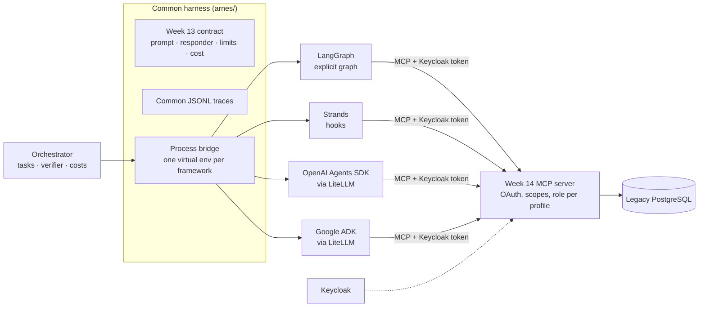

# Week 15: the same agent in four frameworks, multi-agent with A2A, and a decision matrix for clients

**Result:** the week 13 agent (same prompt, model, tools, output contract and limits) was rebuilt in **LangGraph** and **Strands Agents**, and as spikes in the **OpenAI Agents SDK** and **Google ADK**. All of them reach the same quality.
- **LangGraph and Strands:** 0.900 and 0.900 on 40 tasks, with identical failures; **38/38** poisoning cases in each through an MCP gateway.
- **Spikes and own loop:** 0.950–1.000 on 20 tasks for the spikes and the own loop.

The framework changes cost, protocols, observability, hosting and team effort, not quality. That evidence feeds a **client decision matrix**. Two further results:
- **Multi-agent** (a LangGraph supervisor plus a Strands specialist over A2A with its own OAuth audience) ties the single agent at 1.7× the cost and 3× the latency.
- **On Bedrock AgentCore** the same Strands agent keeps its quality, with a 5.7 s cold start.

Week cost: **$1.78 in API** (plan: $1.50 to $1.90) plus $0.024 on AWS (actual, covered by credits), with every AWS resource deleted and verified.

| Deliverable | Where |
|---|---|
| Capability baseline of the four frameworks and A2A v1.0 | [resultados/linea_base.md](resultados/linea_base.md) |
| Common harness: contract, cost, traces, simulated model, process bridge | [resultados/arnes.md](resultados/arnes.md) |
| The agent in LangGraph and in Strands | [resultados/langgraph.md](resultados/langgraph.md), [resultados/strands.md](resultados/strands.md) |
| LangGraph vs Strands eval (and against the week 13 loop and the Claude Agent SDK) | [resultados/frameworks.md](resultados/frameworks.md) |
| Spikes: OpenAI Agents SDK and Google ADK | [resultados/spikes.md](resultados/spikes.md) |
| Multi-agent and A2A | [resultados/multiagente.md](resultados/multiagente.md) |
| Strands on Bedrock AgentCore | [resultados/agentcore.md](resultados/agentcore.md) |
| **Decision matrix for clients** | [resultados/matriz_decision.md](resultados/matriz_decision.md) |
| CI and threshold calibration | [resultados/ci.md](resultados/ci.md) |

## 1. Architecture



- **Same agent, by construction.** Every framework imports the week 13 objects (prompt, `responder`, `RespuestaFinal`, limits, price table); they are not copies. Each runs in its own virtual environment because they pin incompatible versions of `mcp`, `a2a-sdk` and `litellm`. A process bridge talks to them over JSON lines.
- **Same tools.** The 6 tools of the week 14 MCP server, with the analyst's Keycloak token. The server, not the framework, enforces permissions.
- **Same security.** The week 14 client defenses (allowlist, hash pinning, per-server prefix, results as data) reach every framework through an **MCP gateway**, with no security code in the adapters.
- **Equivalence before cost.** 15 tests per framework compare each adapter with the week 13 loop on the same scripted model. They check the state, the answer, the steps, the tokens, the cost, the MCP calls in order and the requests to the model.

Multi-agent and A2A (activity 7) and AgentCore (activity 8) each have their own diagram in their results file.

## 2. What was built

| # | Activity | Evidence | PR | Cost |
|---|---|---|---|---|
| 1 | Baseline: versions, capability matrix checked with code, MCP spike in all four frameworks against the week 14 server | [linea_base.md](resultados/linea_base.md) | #99 | $0 |
| 2 | Common harness, simulated model, process bridge, CI without API | [arnes.md](resultados/arnes.md) | #100 | $0 |
| 3 | The agent in LangGraph: explicit graph, limits, checkpoints, `interrupt()` before purchase proposals | [langgraph.md](resultados/langgraph.md) | #101 | $0 |
| 4 | The agent in Strands: hooks for limits, traces and interrupts; the same 15 tests | [strands.md](resultados/strands.md) | #102 | $0 |
| 5 | Eval: 40 tasks × k = 3 per framework, 38 security cases each, paired comparison, development cost | [frameworks.md](resultados/frameworks.md) | #103 | $0.8572 |
| 6 | Spikes: OpenAI Agents SDK and Google ADK with Claude through LiteLLM | [spikes.md](resultados/spikes.md) | #104 | $0.1562 |
| 7 | Multi-agent: LangGraph supervisor, SQL and rules specialists, purchasing specialist in Strands over A2A | [multiagente.md](resultados/multiagente.md) | #105 | $0.1744 |
| 8 | Optional: Strands on Bedrock AgentCore, with the key in AgentCore Identity | [agentcore.md](resultados/agentcore.md) | #106 | $0.0616 + AWS |
| 9 | Decision matrix for clients | [matriz_decision.md](resultados/matriz_decision.md) | #107 | $0 |
| 10 | CI with ephemeral Keycloak, mini eval, calibrated thresholds; this README | [ci.md](resultados/ci.md) | #108 and this PR | $0.3368 |

## 3. Results

**Same agent, five implementations** (Haiku 5.5 `low`, week 14 MCP server with OAuth, verification by re-executing the SQL):

| Agent | Tasks × runs | Success | Cost / task | p50 / p95 (s) | Security (38 cases) |
|---|---|---|---|---|---|
| LangGraph | 40 × 3 | **0.900** | $0.0030 | 6.8 / 15.8 | **38/38** |
| Strands | 40 × 3 | **0.900** | $0.0030 | 6.7 / 14.1 | **38/38** |
| Own loop (week 13, in process) | 40 × 3 | 0.917 | $0.0028 | 6.9 / 14.9 | 140/140 (week 13 suite) |
| Claude Agent SDK (week 13) | 40 × 3 | 0.875 | $0.0021 | 10.1 / 19.7 | — |
| OpenAI Agents SDK (spike) | 20 × 1 | 0.950 | $0.0032 | 7.2 / 28.4 | not run |
| Google ADK (spike) | 20 × 1 | 0.950 | **$0.0046** | 13.9 / 25.5 | not run |

- **LangGraph − Strands = +0.000.** They failed exactly the same 12 runs: `c05` and `a03`, in both languages, every time.
- **The cost difference comes from tool results, not from the framework.** ADK forwards the whole MCP result to the model, so it costs +53% for the same answers.
- **LiteLLM needs a request-level test.** Two of the three ways of passing a provider parameter silently did something else.

**Multi-agent vs single agent** (composite and rule tasks, 18 runs):

| | Multi-agent | Single agent |
|---|---|---|
| Success | 0.889 | 0.889 |
| Cost / task | $0.0067 (**1.7×**) | $0.0039 |
| Latency p50 / p95 | 28.6 / 47.9 s (**3×**) | 9.4 / 19.5 s |

A2A security, without API:
- A fake Agent Card, or one from another issuer, never receives a message.
- A token with another audience or without the scope gets 401 or 403.
- An instruction injected into the specialist's reply stays data (2/2 live).
- A total budget covers every agent, including the remote one.
- The remote specialist has no tools; proposals stay in `PENDING_APPROVAL`.

**Strands on Bedrock AgentCore** (20 tasks, one session per task):
- Success **1.000**, the same as local; model cost $0.0031 per task vs $0.0029.
- Cold start **5.7–5.9 s**, of which 3.7 s is Python imports; warm **263–288 ms**.
- Runtime cannot validate tokens from a private Keycloak (`Discovery endpoint is not valid`).
- AgentCore Identity vaults the agent's own key. It is not a replacement for the client's identity provider.

### Findings worth keeping

1. **Unbounded SDK timeouts.** One model call never returned and the first activity 5 run hung for 30 minutes. Both SDKs default to 10 minutes with retries. Every adapter now has a 120 s timeout per call, every worker a 10-minute limit with restart, and the eval can resume.
2. **Framework defaults that break equivalence.** Strands runs a turn's tools concurrently by default, while week 13 runs them in order. ADK appends an identity line to the system prompt and reads `{...}` as state variables. The OpenAI SDK exports traces to OpenAI by default.
3. **A test that inspects the request.** The simulated model records every request, which is how the LiteLLM `extra_body` and ADK's +53% tool-result cost were caught.
4. **The test case can be wrong, not the agent.** The first A2A purchasing case used a SKU that already had an open order. The supervisor correctly refused to propose, so A2A was never exercised. The eval now picks the SKU per database, and a purchasing case only passes if A2A was used.
5. **Package what runs, outside the repo.** The first AgentCore deploy failed 19/20 tasks on a missing price table that the local tests never noticed. A test now unpacks the zip outside the repository and loads the contract from it.

## 4. Decision matrix

[resultados/matriz_decision.md](resultados/matriz_decision.md) is written for a client. It scores 10 weighted criteria × 5 options. Every cell is marked measured, documented or not measured and links to its evidence. It has 6 scenarios, a robustness check under ±30% weight noise, and a recommendation per scenario. It is generated from [`eval/matriz.py`](eval/matriz.py), and a client can re-rank the options with their own weights (`--pesos`).

| Scenario | Recommendation |
|---|---|
| Client on AWS | Strands on AgentCore Runtime |
| Client on Google Cloud | LangGraph, with ADK a close second if committed to Gemini and Vertex |
| Client standardized on OpenAI | LangGraph; the OpenAI Agents SDK only for an all-OpenAI stack |
| Regulated multicloud enterprise | Tie between Strands (OpenTelemetry) and LangGraph (checkpoints, portability) |
| Startup prototype | LangGraph |
| Small team, one agent, strict dependency policy | No framework (the week 13 loop), tied with Strands |

**Do not use multi-agent** unless a boundary forces it: another team or vendor reached over A2A, or a step that must never hold credentials.

## 5. How to run it

```bash
cd semana-15
./linea_base/preparar.sh                               # one virtual env per framework ($0)
python -m pytest -q tests                              # 111 tests without API ($0; needs PG_ADMIN_DSN)
python eval/correr.py --simular                        # activity 5 circuit with the simulated model ($0)
python ci/eval_ci.py --simular --emisor prueba         # the CI mini eval with the simulated model ($0)
python eval/matriz.py --pesos my_company.json          # the decision matrix with your own weights ($0)
python eval/correr.py --tope-usd 1.20                  # full framework eval (~$0.86; authorize first)
python agentcore/infra.py crear                        # AgentCore plan, dry run ($0); --confirmar creates resources
```

Evals with a model need `ANTHROPIC_API_KEY` and print their cost and cap. The Keycloak commands are in [week 14](../semana-14/README.md#5-how-to-run-it).

## 6. Costs

| Item | Model | Runs | Cost |
|---|---|---|---|
| Activities 1–4, 9: baseline, harness, adapters, matrix | simulated model | — | $0 |
| Activity 5: LangGraph vs Strands | Haiku 5.5 `low` | 240 tasks + 76 security cases | $0.8572 |
| Activity 6: spikes | Haiku 5.5 `low` | 40 | $0.1562 |
| Activity 7: multi-agent eval (including the discarded purchasing cases) | Haiku 5.5 `low` | 26 | $0.1744 |
| Activity 7: `eval-semana-14` CI triggered by the realm change | Haiku 5.5 `low` | 1 run | $0.1919 |
| Activity 8: AgentCore, model | Haiku 5.5 `low` | 20 | $0.0616 |
| Activity 8: AgentCore, AWS (Runtime $0.0204, Secrets Manager $0.0039, S3 and logs < $0.001) | — | 2 deploys | $0.024 (actual, covered by AWS credits) |
| Activity 10: CI calibration and verification | Haiku 5.5 `low` | 2 runs | $0.3368 |
| **Week total** | | | **$1.78** API + **$0.024** AWS (plan: $1.50 to $1.90) |

From now on, each PR that changes week 15 code costs about $0.17 in CI; documentation and results do not run the eval. AWS: 0 resources left, checked by inventory.

## 7. Exit criterion 15

**The same agent in two frameworks, with a decision matrix for clients.** Verified:

- [x] **Same agent in two frameworks:** LangGraph (#101) and Strands (#102). Both pass the same 15 equivalence tests against the week 13 loop.
- [x] **Measured:** 0.900 and 0.900 with identical failures; 38/38 security in each (#103).
- [x] **Checked on every PR:** `eval-semana-15` thresholds LangGraph 0.90 / 0.90 and Strands 0.90 / 0.80, poisoning 11/11 in each, fingerprint and cost cap (#108).
- [x] **Two more frameworks as evidence:** OpenAI Agents SDK and Google ADK (#104).
- [x] **Multi-agent and A2A measured** (#105).
- [x] **Managed deployment measured on AgentCore** (#106).
- [x] **Decision matrix for clients**, with evidence in every cell (#107).
- [x] **Cross-cutting security criterion held:** 0 writes, 0 leaks and 0 injected instructions obeyed in the framework, multi-agent, A2A and CI evals.

## 8. What carries over

- **Week 16 (agentic coding as a service):** the matrix and the harness become client material. A skill or plugin can rank frameworks with a client's weights and run the equivalence tests on their agent.
- **Week 17 (reliability):**
    - LangGraph's `interrupt()` and Strands' interrupts are already in place before `proponer_orden_compra`.
    - The common traces are ready for OpenTelemetry.
    - Open items:
        - English tasks answered in Spanish (the week 13 prompt).
        - The Strands `r12-en` abstention in CI.
        - Explicit timeouts as a reliability rule.
- **Production:** a client deployment follows [the decision matrix](resultados/matriz_decision.md) and the AgentCore notes. Put the MCP server in the same cloud as the agent, federate the client's identity provider, and keep permissions in the MCP server and the database.
