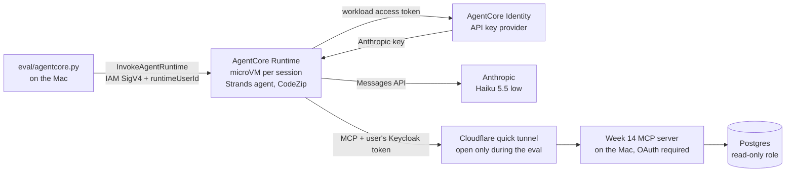

# Activity 8 (optional): Strands on Bedrock AgentCore

**Result:** the Strands agent from activity 4 runs unchanged on AgentCore Runtime with the **same success (1.000 on the 20-task mini eval) and the same model cost ($0.0031 vs $0.0029 per task)**. What AgentCore adds is operational: isolated microVMs per session, a credential vault, and a deploy that reaches `READY` in about 35 s. What it costs is latency: a **cold start of 5.7–5.9 s** on every new session (3.7 s of it is Python imports), against **263–288 ms** warm. AgentCore Identity does **not** replace Keycloak here. Inbound, it needs a publicly reachable identity provider; outbound, it is a vault for the agent's own secrets, not a login for users. Total cost: **$0.062 in model usage** plus an estimated **< $0.05 in AWS**. Every resource was deleted and verified; only the $2 budget remains until the bill is reviewed.

Code:
- [`agentcore/main.py`](../agentcore/main.py): the agent entry point on Runtime.
- [`agentcore/empaquetar.py`](../agentcore/empaquetar.py): CodeZip package, ARM64, Python 3.13, 31.6 MB.
- [`agentcore/infra.py`](../agentcore/infra.py): create, delete, inventory, JWT probe; dry run by default.
- [`eval/agentcore.py`](../eval/agentcore.py): the eval.

Tests: [`tests/test_agentcore.py`](../tests/test_agentcore.py) (7, no AWS and no API). Generated tables: [`agentcore_tablas.md`](agentcore_tablas.md). Detail: [`agentcore_detalle.jsonl`](agentcore_detalle.jsonl); traces: [`trazas/agentcore.jsonl`](trazas/agentcore.jsonl) (231 events, framework `strands@agentcore`).

## Architecture

| Decision | Why |
|---|---|
| Same code as the local worker: `main.py` calls `arnes.puente.resolver_peticion`, the function the local process bridge uses | The only differences between local and cloud are where the agent runs and where the key comes from |
| Anthropic API, with the key in **AgentCore Identity** (API key credential provider) | Same model provider as activities 5–7. The key is not in the package, the environment or the code. The agent fetches it per process with the workload token that Runtime hands it |
| boto3 instead of the AgentCore CLI | The CLI deploys with CDK and leaves the CDK bootstrap behind (stack, bucket, ECR repository, roles). Here every resource is created and deleted explicitly with the `semana15` prefix, and an inventory checks that nothing is left |
| Minimal execution role | Trust only from AgentCore of this account and region. Permissions only for its own log group, its own workload identities, **its** key provider, **its** secret and its own code object. No Bedrock, no ECR, no IAM |
| Sessions: 60 s idle, 15 min maximum life | Caps what an abandoned session can cost |
| Tools through a **temporary tunnel** to the week 14 MCP server | The agent in AWS cannot reach `127.0.0.1`. The tunnel exists only during the eval, the server still requires the Keycloak token (audience and scopes), and Host is rewritten to loopback so its DNS-rebinding protection is unchanged. Keycloak and Postgres are never published |
| The user's MCP token travels in the invocation payload (TLS) and is never logged | Same token-for-the-user model as week 14; neither `main.py` nor the adapter print the payload |

## Controls before spending

| Control | Evidence |
|---|---|
| Cost estimated before running (Runtime, Identity, Gateway, Observability, model) | $0.12–0.25 estimated; authorized by the user |
| AWS budget with alerts | `semana15-agentcore`, $2 per month, email alerts at 50% and 100% actual and 100% forecast. AWS alerts, it does not stop spending, which is why the sessions are capped too |
| Deploy and teardown scripts tested | Dry run by default, tested without AWS (`test_crear_y_borrar_en_simulacion_no_tocan_aws`). Run for real twice: both teardowns ended with `"quedan": "nada"` (nothing left) |
| Inventory before and after | 0 resources in 10 categories before. After: runtimes, workload identities, key providers, secrets, roles, buckets, log groups, stacks and ECR repositories all empty; only the budget remains |
| The package carries no secrets | `empaquetar.py` lists the zip and fails on `.env`, keys or credentials; `test_paquete_solo_lleva_el_codigo_necesario` |

## Mini eval: the same agent, local vs AgentCore

The 10 week 13 CI tasks per language (the activity 6 subset), k = 1, one new session per task (one user per request), real Keycloak, same verifier.

| Agent | Runs | Success | 95% CI | Model cost / task | Agent time p50 / p95 (s) | Client time p50 / p95 (s) |
|---|---|---|---|---|---|---|
| Strands on AgentCore | 20 | **1.000** | 0.839 to 1.000 | $0.0031 | 7.1 / 21.3 | **13.3 / 27.1** |
| Strands local (activity 5, k = 3) | 60 | **1.000** | 0.940 to 1.000 | $0.0029 | 6.5 / 19.0 | same as agent time |

- **Quality and model cost do not change.** Same states (including the expected clarification on `a01` and abstention on `n01`), 3.65 model calls per task.
- **Agent time +0.6 s at p50:** each MCP call now goes from AWS through the tunnel to the Mac and back. With the MCP server in the same cloud this would disappear.
- **Client overhead: 6.0 s at p50** (5.3 to 7.5 s), which is the cold start. All 20 tasks landed on a fresh process, because each one opened a new session.
- **Database fingerprint unchanged.**

## Start-up latency

| | Runs | Client latency |
|---|---|---|
| Cold: new session (`ping`, no model) | 3 | 5,902 / 5,659 / 5,732 ms |
| Warm: same session | 3 | 275 / 288 / 263 ms |

Inside the microVM the process was 4.0–4.2 s old when it answered, and **3.7 s of that was importing Python** (Strands, the Anthropic SDK, MCP, OpenTelemetry). The rest is microVM start and the Runtime path. Levers, not measured here:
1. Reuse the session for a user's conversation: warm is 21× faster.
2. Import lazily, or trim dependencies (the OpenTelemetry instrumentation comes with Strands).
3. Run a container image instead of CodeZip.

## AgentCore Identity vs our Keycloak

| Question | AgentCore Identity | Keycloak (weeks 14–15) | Evidence |
|---|---|---|---|
| Who may call the agent (inbound) | IAM (SigV4), or a JWT authorizer that points to an OIDC discovery URL | Issuer of the user's token with audience and scopes per resource (RFC 8707) | |
| Can Runtime validate our Keycloak tokens? | **Not while Keycloak is private**: `CreateAgentRuntime` fails with `Discovery endpoint is not valid`. AWS fetches the discovery document itself | — | `probar-jwt`, run 1 |
| User identity with IAM inbound | `runtimeUserId` is **asserted by the caller**, not verified: the AWS docs warn that `GetWorkloadAccessTokenForUserId` trusts it. Without it, Runtime issues **no** workload token, so the agent gets no key | The token's `sub` is signed by the IdP | Invocation without `runtimeUserId` → `sin workload access token`; 0 model calls |
| Agent's own secrets (outbound) | **Strength:** credential vault (API keys, OAuth 2.0 to third parties) bound to the agent's workload identity, scoped by IAM | Not its job | The key never left Identity; deleted with the provider |
| Delegated access on behalf of the user (3LO) | OAuth providers with a user consent flow and a public callback | Authorization code + PKCE flow, already used by Claude Code (week 14) | Not exercised here |
| Permissions over the data | None: those stay in the MCP server and the database | Scopes → filtered tool catalog → a PostgreSQL role per profile | Week 14 |

**Conclusion:** they solve different layers.
- **Keycloak**, or any OIDC IdP, stays the source of user identity and permissions.
- **AgentCore Identity** keeps the agent's own credentials out of code. With a public IdP, the Runtime's JWT authorizer would replace IAM inbound and make the user's identity verified instead of asserted.

In production:
- Publish Keycloak over HTTPS, or federate it with Cognito or Entra ID, and use the JWT authorizer.
- Keep scopes and per-profile roles in the MCP server.
- Put the MCP server in the same cloud as the agent: Runtime with the MCP protocol, or behind AgentCore Gateway. That removes the tunnel.

## What was not used, and why

- **Gateway:** the agent already speaks MCP with OAuth to our server; Gateway would front it in production ($0.005 per 1,000 calls).
- **Memory:** the agent is stateless per task.
- **Observability with Transaction Search:** that is an account-level setting. Here only the Runtime's CloudWatch logs were used, and they were deleted with the runtime.

## Problems found

| Run | Problem | Fix |
|---|---|---|
| 1 | 19/20 tasks failed with `FileNotFoundError: /var/task/semana-07/prices.json`. The package lacked the price table that the week 13 contract reads. The local test passed because it ran inside the repo | Price table added to the package; new test `test_paquete_funciona_fuera_del_repositorio` unpacks the zip outside the repo and loads the contract (it fails without the file). Run 1 kept in `agentcore_corrida1_*` |
| 1 | 1/20: `NoRegionError` creating the AWS client from 2 threads | One boto3 session and client per thread, with the region explicit |
| 1 | `-0.000` lower CI bound in the generated table | Formatting fixed |

## Cost

| Item | Cost |
|---|---|
| Model, run 1 (tasks failed before calling the model) | $0.0000 |
| Model, run 2 | **$0.0616** |
| Runtime: about 48 sessions, about 3 min of agent time, 60 s idle cap | < $0.05 (estimate; CPU is not billed while waiting on the LLM or the tools) |
| Identity, S3, CloudWatch Logs, budget | ≈ $0 (Identity is free through Runtime; storage for minutes; the first 2 budgets are free) |
| **Total** | **≈ $0.06 model + < $0.05 AWS** (estimate was $0.12–0.25) |

The AWS charge is confirmed in Cost Explorer after 24 h, as in week 12. Then the budget is deleted with `python agentcore/infra.py borrar --confirmar --presupuesto`.

## When to recommend AgentCore

| Client situation | Recommendation |
|---|---|
| Already on AWS, many users, agents that must be isolated per session, no wish to run servers | **AgentCore Runtime**: per-session microVMs, per-second billing with I/O wait free, deploy in about 35 s |
| Interactive chat where the first answer must be fast | AgentCore with session reuse, or keep a warm process; a 6 s cold start per new session is visible |
| Identity is already an enterprise IdP | Federate it and use the JWT authorizer; use Identity for the agent's own third-party secrets |
| Multicloud or on-premises data | The agent framework (Strands, LangGraph) stays portable; AgentCore is the AWS hosting option, alongside Vertex AI Agent Engine and LangSmith Deployment |
