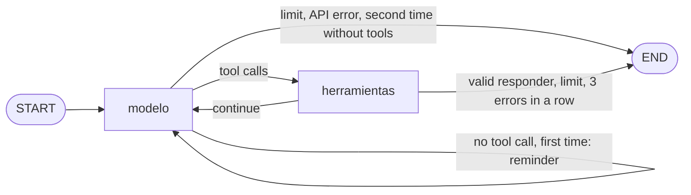

# Activity 3: the agent in LangGraph

Code: [`adaptadores/langgraph.py`](../adaptadores/langgraph.py) (about 145 lines of code without docstrings). Tests: [`tests/test_langgraph.py`](../tests/test_langgraph.py) (15, no API calls, $0), run against the week 13 own loop with **the same simulated model script and the same week 14 MCP server**.

## The graph

It is an explicit `StateGraph`, not the prebuilt `create_react_agent`, so every week 13 rule is visible in the code:

| Week 13 rule | In the graph |
|---|---|
| System prompt, model, effort, output tokens | `ChatAnthropic(model, max_tokens, output_config={"effort": "low"})` with the week 13 `SISTEMA` and task message (same objects, `arnes.Registro`) |
| Tools | The 6 tools of the week 14 MCP server through `langchain-mcp-adapters`, with the user's Bearer token, in **one MCP session per task** (activity 1: without it the adapter opens one session per call), plus `responder` |
| `responder` validated with `RespuestaFinal` + `revisar_final`, alone in its turn | Same code (`Registro.responder`); called alongside other tools is rejected |
| One reminder when the model answers without tools, then stop | `recordatorio` in the state |
| Limits on steps, tokens and time before each model call; tools before each tool; 3 tool errors in a row | Same order and same reasons (`max_pasos`, `max_herramientas`, `max_tokens_total`, `errores_herramienta`, `sin_responder`). `max_tokens_total` is the cost cap. LangGraph's `recursion_limit` is only a safety net |
| Server tool errors (`permiso_denegado`, `sql_invalido`…) go back to the model | The adapter raises `ToolException` on `isError`; the graph turns it back into the server's structured error, not a protocol failure |
| Checkpoints | `InMemorySaver`, one thread per run |
| **Human in the loop** | Before `proponer_orden_compra` the graph stops with `interrupt()` and waits for `Command(resume="aprobar" | "rechazar")`. In evals the `aprobacion` policy decides; in week 17 a person decides through the `decidir` hook. A rejected proposal never reaches the server and goes back to the model as `rechazada_por_humano` |

## Tests (vs. the week 13 own loop, same script)

| Test | Result |
|---|---|
| **Contract equivalence**, 7 scripts: correct answer, wrong SQL, abstention, clarification, never calls `responder`, invalid then corrected answer, `responder` together with another tool | Identical state, final answer, steps, tools, tokens, cost, tool errors, stop reason and parallel turns; the same verifier verdict; **the same calls to the MCP server in the same order**; the same requests to the model (system prompt, model, `max_tokens`, `effort`, tool set, first message); valid common traces |
| **Limits** `max_pasos`, `max_herramientas`, `max_tokens_total` | Same stop reason and the same counters as the own loop |
| 3 tool errors in a row | Both stop with `errores_herramienta` after 3 |
| **Interrupt before `proponer_orden_compra`**, approve | One pause with the tool and its arguments; the server receives the proposal; ≥ 4 checkpoints |
| Interrupt, reject | One pause; **the server receives nothing**; the model gets `rechazada_por_humano` |
| No policy (`aprobacion=None`) | No pause, same behavior as week 13 |
| Profile without `legado:compras:proponer` (almacenista) | The server never listed the tool, so there is no pause and no call. **Human approval never replaces permissions** |

## Finding

The first version checked `max_herramientas` before each model call. Week 13 checks it only before each tool, so with `max_herramientas=1` LangGraph stopped one step earlier (1 step against 2). The equivalence test caught it, and the check moved into `Registro.herramientas_agotadas()` so the Strands adapter inherits the right order.
