# Week 19: LegacyBridge on AWS, from IaC

> Spanish names (folders, files, JSON keys, flags, stack names, status values) are explained in the [glossary](../docs/glossary.md). The documentation is in English. Spanish data and recorded results stay as they are: the [data guide](../docs/data/README.md) and the README in each data or results folder describe them in English.

LegacyBridge's agent (weeks 13 to 17) answers questions about a legacy inventory database in plain language, and it proposes purchase orders that a person approves. In week 19 it runs in an AWS account, built from code:
- the API behind Cognito;
- the agent in Lambda, on Bedrock with a Guardrail and versioned prompts;
- the tools in a private VPC next to RDS PostgreSQL;
- the human approval in Step Functions.

Everything is measured: what it costs, how well it answers, how it was secured, and that the teardown leaves nothing behind.

The week is for whoever deploys it, reviews it, or picks it up in week 20. The plan and the Log are in [Fas5Sema19.md](Fas5Sema19.md).

Every figure below links to the results file it comes from.

## For decision-makers

- **It runs in your AWS account, built from code.** Four layers deployed with CDK, with 0 unsuppressed cdk-nag findings and 0 failed checkov checks ([seguridad.md](resultados/seguridad.md)).
- **Your data stays on a private network.** The tools and the database sit in a VPC with no internet path; RDS has no public IP, and the API is the only public resource, with a JWT authorizer on every route ([verificacion.json](resultados/seguridad/verificacion.json)).
- **The cost is measured, and so is the quote.** 0.030913 USD per query for the model and 0.037562 USD per hour of stack, from the bill ([costo_real.md](resultados/costo_real.md)). The quote model missed by −0.1% per query and −10.3% per hour ([cotizacion.md](resultados/cotizacion.md)).
- **Nothing is left running after a session.** The teardown is checked by a read-only inventory that must end in `"quedan": "nada"` ("left: nothing") ([inventario_final.json](resultados/inventario_final.json)).
- **The security findings are open and planned, not hidden.** Each one has its risk and its fix: throttling (H1) and the async timeout (H4) are in week 20, red teaming in week 21 ([threat_model.md](seguridad/threat_model.md)).



## Detailed architecture



Source: [arquitectura/diagrama.mmd](arquitectura/diagrama.mmd). [tests/test_diagrama_vs_stack.py](tests/test_diagrama_vs_stack.py) checks it against the synth, both ways. The client view above ([arquitectura/diagrama_simple.mmd](arquitectura/diagrama_simple.mmd), 8 boxes) is a summary of this one, and that test does not check it.

**Four layers**, one stack each, deployed in this order:

| Layer | Stack | What it holds |
|---|---|---|
| Network and key | `semana19-base` (stack names start with `semana19-`, "week19-") | the VPC (isolated subnets, no internet gateway, no NAT), the endpoints of ADR 0005, the project's KMS key, the flow logs |
| Data | `semana19-datos` | RDS PostgreSQL with the legacy schema, the KB's documents bucket, the Knowledge Base on S3 Vectors |
| AI | `semana19-ia` | the Bedrock Guardrail and the Prompt Management prompts (ES and EN), each at a fixed version |
| Compute | `semana19-computo` | Cognito, the HTTP API, the Lambdas (queries, agent, tools, approver, order writer), DynamoDB, the Step Functions approval |

Around them:
- `semana19-control`: the budget and its action, the deploy role, the permissions boundary and the CloudFormation execution policies.
- The `s19` CDK bootstrap.
- Two disposable stacks: `semana19-gateway` (AgentCore Gateway, activity 7) and `semana19-eval` (the judge's bucket, activity 8).

**Trust boundaries F1 to F11** are the diagram's boxes. They are analyzed in [seguridad/threat_model.md](seguridad/threat_model.md).

## Decisions (ADRs)

| ADR | Decision | Why |
|---|---|---|
| [0001](arquitectura/adr/0001-cdk-vs-terraform.md) | CDK in Python, not Terraform | the needed Bedrock and AgentCore resources exist as stable L1 constructs |
| [0002](arquitectura/adr/0002-http-api-vs-rest-api.md) | HTTP API in the lab, REST API with WAF in prod | the lab needs only the JWT authorizer and its routes; prod needs WAF, usage plans and validation |
| [0003](arquitectura/adr/0003-rds-vs-aurora-vs-data-api.md) | RDS PostgreSQL db.t4g.micro, Single-AZ, IAM auth | the lowest measured fixed cost, and no capacity units to explain |
| [0004](arquitectura/adr/0004-lambda-agent-vs-agentcore-runtime-vs-bedrock-agents.md) | the agent in Lambda | one demo user needs no session isolation; the cold start is measured |
| [0005](arquitectura/adr/0005-interface-endpoints.md) | only the endpoints the VPC needs; S3 through a gateway endpoint | interface endpoints are billed per AZ-hour |
| [0006](arquitectura/adr/0006-una-az-para-endpoints.md) | one AZ for the endpoints in the lab, three in prod | the lab accepts that an AZ failure stops the tools |
| [0007](arquitectura/adr/0007-sincrono-o-asincrono.md) | asynchronous queries (202 and polling) | the API never waits on the agent loop, whatever its length |
| [0008](arquitectura/adr/0008-describir-esquema-y-kb.md) | the tools Lambda serves the schema; the agent retrieves from the KB | no extra endpoint. Not implemented: finding H2 |
| [0009](arquitectura/adr/0009-scopes-desde-grupos.md) | scopes from Cognito groups, through a pre-token trigger (V2) | the 403 is enforced at the API, not in code |
| [0010](arquitectura/adr/0010-flujo-oauth-actividad-8.md) | authorization code with PKCE and managed login | the eval uses real user tokens |
| [0011](arquitectura/adr/0011-task-token-en-dynamodb.md) | the Step Functions task token in DynamoDB, with a TTL equal to the approval timeout | only the approval step writes orders, as `order_writer` |
| [0012](arquitectura/adr/0012-concurrencia-reservada.md) | reserved concurrency on the Lambdas, within the account quota | it bounds a flood (with H1 still open) |
| [0013](arquitectura/adr/0013-contrasenas-de-prueba-local.md) | test passwords in a local file outside the repository | test users do not justify a paid secret |

## Deploy and destroy

**Before you start:**
- An `aws login --profile <admin-profile>` session. Every profile chains from it.
- The two other profiles:
  - `semana19-despliegue`, which assumes the deploy role for `cdk deploy` and `cdk destroy`;
  - `semana19-lectura`, which is read-only (inventory, verification, Cost Explorer).
- `.venv` and `.venv-cdk` built with the pins of the `semana19` group (`pyproject.toml`, [preparar/versiones.json](preparar/versiones.json)).
- `ALERTA_EMAIL` exported in the shell. It is never written to the repository.
- Access to Haiku 4.5 through the `us.` inference profile. Haiku 5.5 has an on-demand quota of 0: its increase requests were closed without a change ([resultados/linea_base.md](resultados/linea_base.md), section 10).
- The `proyecto` cost allocation tag active.

**Commands**, from the worktree root. Each script only simulates unless it gets `--si` ("yes": act). `desplegar.sh` deploys and `destruir.sh` destroys:

```
semana-19/infra/desplegar.sh
semana-19/infra/desplegar.sh --diff
semana-19/infra/desplegar.sh --si
.venv/bin/python semana-19/infra/usuarios.py --pool <pool-id> --perfil <admin-profile> --si
semana-19/infra/destruir.sh --si --todo
semana-19/infra/destruir.sh --inventario
```

- **`desplegar.sh`** deploys control, then the bootstrap, base, datos, ia, and the loader with the KB ingestion. `--diff` is read-only. Computo is deployed after it, on its own: `COMPUTO=1 CAMINO_HERRAMIENTAS=directo cdk deploy semana19-computo --exclusively` with the `semana19-despliegue` profile and the `semana19-cdktoolkit` toolkit stack.
- **`usuarios.py`** creates one test user per Cognito group. It takes the profile from `--perfil` (or `S19_PERFIL_DESPLIEGUE`), not from `S19_PERFIL`. Their passwords go only to `<secrets-dir>/usuarios-prueba.env`, outside the repository (ADR 0013).
- **`destruir.sh --si --todo`** deletes everything in reverse order, then runs the inventory. Without `--todo`, the control stack stays; it costs $0/h.
- **`destruir.sh --inventario`** lists what is left, using the read-only role. The proof of an empty account is `"quedan": "nada"`, apart from an explicit list:
  - the read-only role;
  - the KMS keys pending deletion;
  - the control stack, without `--todo`.

**Measured times** of the last full run, on 2026-11-21 and 2026-11-22 ([resultados/tiempos_despliegue.jsonl](resultados/tiempos_despliegue.jsonl)):

| Deploy step | s | Teardown step | s |
|---|---|---|---|
| control | 45–70 | computo | 2,415 |
| bootstrap | 3–56 | datos | 1,287 |
| base | 92 | base (keeping the default-SG custom resource) | 34 |
| datos | 755 | bootstrap | 32 |
| ia | 81 | control | 66 |
| load and ingest the KB | 8 | | |
| computo | 576 | | |

Two known failures, each with its fix:
- **Base can fail to delete.** It ends in `DELETE_FAILED` on CDK's custom resource that restricts the default security group, because the boundary has no `ec2:Authorize*`. `destruir.sh` retries and keeps that one resource ([resultados/base.md](resultados/base.md), "Teardown final").
- **The deploy failures of 2026-11-21** were fixed in #304 to #309 ([resultados/seguridad.md](resultados/seguridad.md)).

## What it costs (measured)

| Figure | Value | Source |
|---|---|---|
| Per hour of the lab stack, from the bill | **0.037562 USD**, over 26.004 h | [resultados/costo_real.md](resultados/costo_real.md) |
| Per query, the model alone, from the bill (the figure that counts) | **0.030913 USD**, 57 tasks; it reconciles with the spans | [costo_real.md](resultados/costo_real.md) |
| Per query, every per-query line (an upper bound: it also holds the judge's job, ApplyGuardrail and Titan) | 0.038562 USD | [costo_real.md](resultados/costo_real.md) |
| Quote error, model v2 | −0.1% per query (model), +24.6% (upper bound), −10.3% per hour | [resultados/cotizacion.md](resultados/cotizacion.md) |
| Quote per month, model v2, 100 queries a day and 8 h a day | lab 103.0676 USD, prod 115.5164 USD (prod not measured: never deployed) | [cotizacion.md](resultados/cotizacion.md) |
| The security review (activity 9) | about 0.73 USD of usage, net 0.00 USD with credits | [resultados/seguridad.md](resultados/seguridad.md), step 4.7 |

The quote comes from [costos/modelo.py](costos/modelo.py). v1 is kept with `--version v1`.

## Eval against the deployed endpoint: regression, 9/20

The 20 golden tasks of week 13 ran through the public API with real Cognito tokens, judged by week 13's execution verifier ([resultados/eval_aws.md](resultados/eval_aws.md), run of 2026-11-19).

| | Result |
|---|---|
| Success | **9/20** (0.45, Wilson 95% [0.258, 0.658]); es 7/10, en 2/10; 3 tasks aborted by the script's cap |
| Regression (week 10's rule, against week 17 local 20/20) | **yes**, in es, en and total |
| Trajectory (week 17's graders) | 17 graded, 7 OK, mean score 0.923 |
| Latency | cold p50 49.95 s (n = 1); warm p50 23.52 s, p95 30.13 s (n = 17) |
| Bedrock model evaluation (Nova Pro as judge) against the verifier | agreement 0.8, kappa 0.5946 (n = 15); 2 false fails, 1 false pass |

**Why it regresses** ([eval_aws.md](resultados/eval_aws.md), "Why it regresses"):
- **The per-task token budget, 5 of the 11 failures.** The budget is week 17's, calibrated on Haiku 5.5. The deployed Haiku 4.5 needs more turns.
- **No prompt cache.** There is no `cachePoint`, so every turn pays again for the system prompt and the tools.
- **c02 abstains in both languages**, where an answer was expected.
- **c06-en answers in Spanish.**

Two more things to read with the result:
- The 20/20 baseline ran Haiku 5.5 locally, so the comparison also crosses models.
- The fixes need a new paid run. They go to week 20, which measures caching and routing against this baseline.

## Three ways to reach the tools

From [resultados/agentes.md](resultados/agentes.md), on the same 10 Spanish tasks:

| Path | Success | Latency p50 / p95 (s) | Model cost (USD) |
|---|---|---|---|
| (a) direct `lambda.invoke` from the agent loop | 10/10 | 18.51 / 40.75 | 0.2405 |
| (b) AgentCore Gateway with the user's token, Cedar policies in ENFORCE | 9/10 | 15.76 / 41.16 | 0.2410 |
| (c) Bedrock Agents | not measured | — | — |

- **Path (c) could not be created.** Bedrock Agents refused `CreateAgent` in this account (`AccessDenied`, maintenance mode for accounts without prior use).
- **Decision:** (b) for production, because it enforces authorization outside the loop; (a) stays the lab default.

## Security review

Summary of [resultados/seguridad.md](resultados/seguridad.md) (activity 9):

| Check | Result |
|---|---|
| Unsuppressed scanner findings | 0, in gitleaks, checkov, cdk-nag and ValidatePolicy; each suppression has a reason. In CI, parliament also runs with every finding classified ([seguridad/parliament.json](resultados/seguridad/parliament.json)) |
| The deployed stack, read-only | 5 of 6 checks ok. The failure is encryption: H14 is new, H10 was already open ([seguridad/verificacion.json](resultados/seguridad/verificacion.json)) |
| Public resources | none except the API ([verificacion.json](resultados/seguridad/verificacion.json)) |
| External access (IAM Access Analyzer) | 0 findings, 61 resources analyzed ([seguridad/access_analyzer.json](resultados/seguridad/access_analyzer.json)) |
| Indirect prompt injection | 0 of 8 obeyed, in two runs. Tool results are sanitized since #310, with a residual case (iny-d3) |
| Budget action | fired and attached the deny policy (EXECUTION_SUCCESS) |

Open findings, from [seguridad/threat_model.md](seguridad/threat_model.md):

| Week | Findings |
|---|---|
| 20 | H1 (no throttling on the API stage), H2 (KB not on the request path), H4 (no on-failure destination), H10 (resources outside the CMK) |
| 21 | H3 (gateway tools callable directly), H5 (one DB role for every reader), H8 (vendored packages not scanned), H13 (residual case), and the hardening items H7, H12, H14 |
| accepted for the lab | H6 (password login, no MFA), H11 (no trail of data events) |

## What is lab-only

From the profiles file [spike/perfiles.json](spike/perfiles.json) and the threat model:

| Setting | Lab | Prod |
|---|---|---|
| Removal policy | `DESTROY` | `RETAIN` |
| KMS key deletion window | 7 days | 30 days |
| Log retention | 14 days | 365 days |
| Flow log retention | 1 day | 365 days |
| AZs for the endpoints and the tools | 1 | 3 |
| Database | Single-AZ, no deletion protection | Multi-AZ, deletion protection |
| Front door | HTTP API, no WAF | REST API with WAF |
| Test users | admin password login, MFA off (H6) | no admin password auth, MFA on |
| Trail of Bedrock and gateway data events | none (H11) | a trail with advanced event selectors |

Prod is synthesized and costed, never deployed.

## Handoff to week 20

1. **The per-query reference cost:**
   - 0.035544 USD per task from the agent spans, row by row in [resultados/eval_aws_detalle.jsonl](resultados/eval_aws_detalle.jsonl) (19 tasks);
   - 0.030913 USD per task for the model, from the bill ([costo_real.md](resultados/costo_real.md)).
2. **Tags.**
   - During week 19 only the base and datos stacks were tagged `proyecto=semana19` and `perfil=lab|prod`. The control, ia, computo, gateway and eval stacks carried no tags, so their costs never appeared under `proyecto`. The model lines are not tagged resources in any case.
   - Since week 20's preparation (#322), every stack carries `proyecto`, `perfil` and `componente`, from `etiquetas()` in `infra/cdk/app.py`, checked by `tests/test_infra_etiquetas.py`.
   - `proyecto` is active as a cost allocation tag. It read `Active` in [resultados/eval_aws/cost_explorer.json](resultados/eval_aws/cost_explorer.json) (call 1, 2026-11-19). Whether `perfil` is active was not checked. `componente` can be activated only after a deployed resource carries it.
3. **The model interface.**
   - `MODELO_ID` lives in [ia/config.py](ia/config.py).
   - Since #322 the agent calls the model through `modelo.invocar` ([agente/modelo.py](agente/modelo.py)), a thin seam over the Converse adapter with no change in the request. Caching and routing go in there.
   - `agente/construccion.py` still repeats `MODELO_ID`, because `ia/` is not in the Lambda package. `tests/test_agente_modelo.py` checks that the two are equal.
4. **Spans.** They follow week 17's locked schema (`semana-17/instrumentacion/esquema.py`). `agente/exportador.py` writes them as JSON lines to the agent Lambda's CloudWatch Logs group. Week 20 adds X-Ray.
5. **Prod window.** Prod has never been deployed, so there is no measured per-hour figure for it ([cotizacion.md](resultados/cotizacion.md)). The window is still to schedule.
6. **Inherited:**
   - the eval regression (9/20) and its three fixes: the token budget for the deployed model, a `cachePoint`, and c02's use of R-OC-APRUEBA;
   - a local Haiku 4.5 baseline, to split the model's effect from the port's;
   - H1, H2, H4 and H10.

## More

- AIP-C01, by exam domain: [resultados/aip_c01.md](resultados/aip_c01.md).
- Architecture and IaC choice: [resultados/arquitectura.md](resultados/arquitectura.md).
- Foundation: [resultados/base.md](resultados/base.md).
